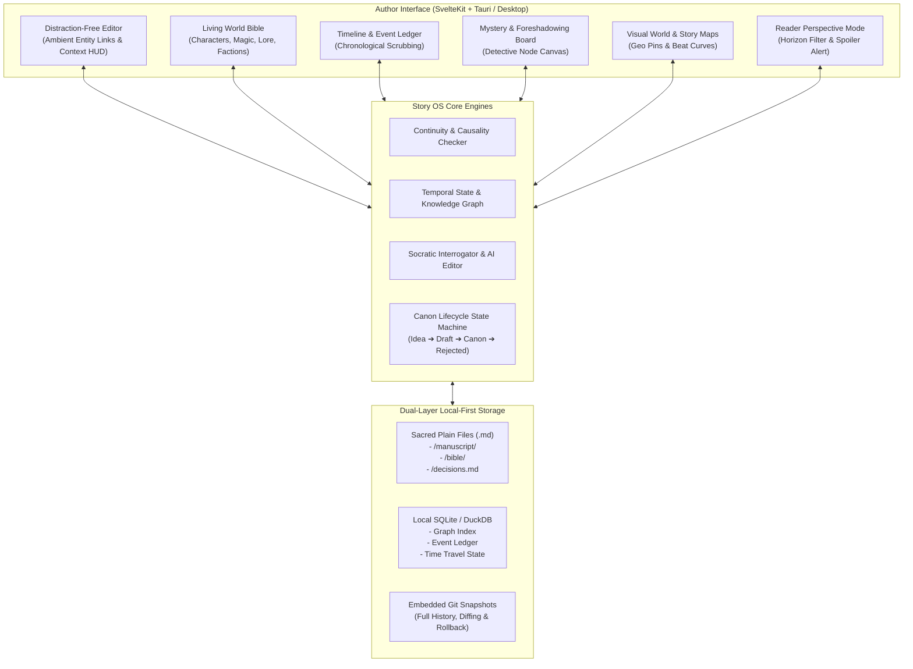
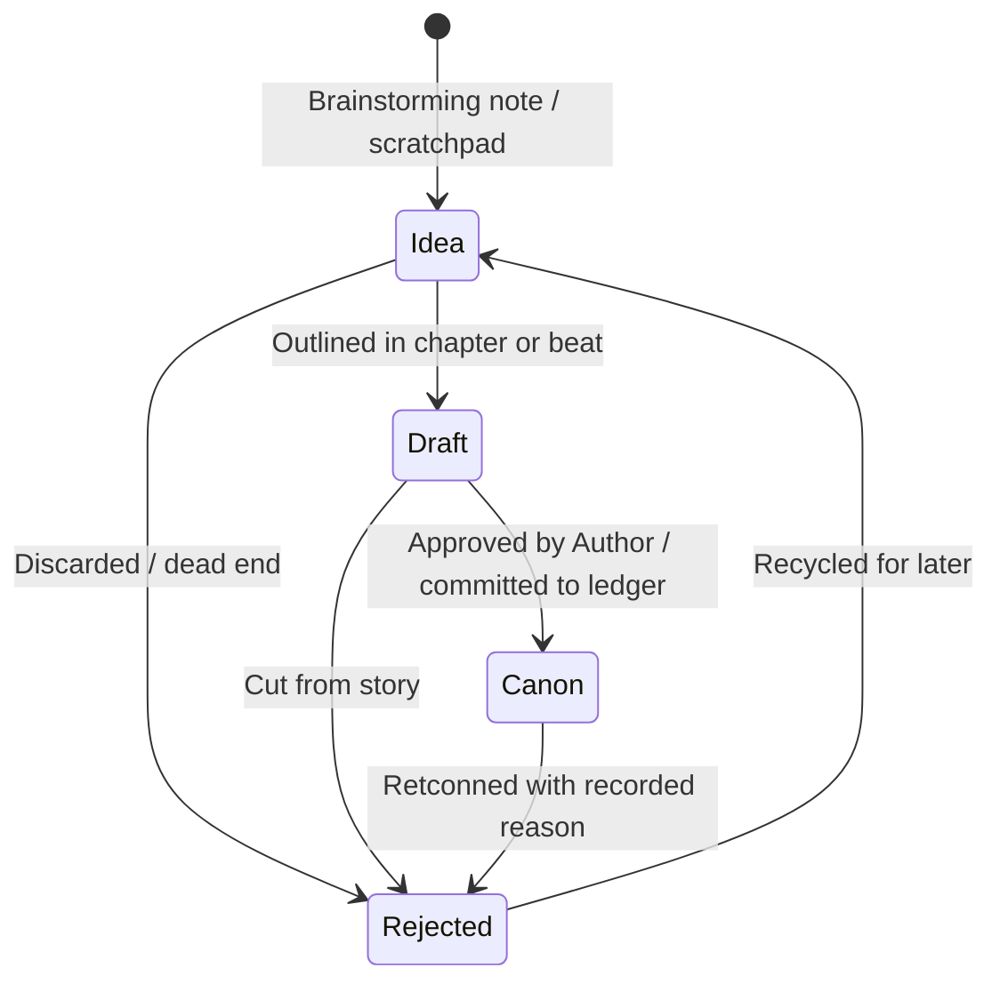
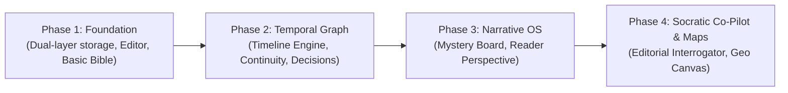

# Story OS: Master Architecture Blueprint & Roadmap
> *"The author owns the story. The tool protects the story."*

---

## 1. Executive Vision & Core Philosophy

Traditional document processors (Google Docs, Word) treat prose as flat text strings. Story organizers (Scrivener) organize text files into tree hierarchies, but treat narrative logic as passive notes. 

**Story OS** is designed as a relational, temporal operating system for long-form fiction:
- **Manuscripts and World Bibles are living, interconnected graphs**, not isolated documents.
- **Entities possess temporal state**: A character’s known secrets, physical injuries, relationship alliances, and motivations evolve on an explicit timeline.
- **The AI is a Socratic developmental editor**, never a ghostwriter. It interrogates decisions, identifies plot holes, points out pacing lulls, checks voice, and tests motivations, but **never modifies canon without author approval**.
- **The reader's information horizon is strictly separated from author omniscience**, enabling automated spoiler detection and pacing audits.



---

## 2. Dual-Layer Storage & Persistence Architecture

To guarantee total author ownership, zero vendor lock-in, and offline security:

1. **Layer 1: Human-Readable Markdown on Disk (`/project-root/`)**
   - Every entity (character, location, magic rule, faction) and manuscript scene exists as an accessible `.md` file with YAML frontmatter.
   - Author files can be read, edited in any external editor (Cursor, VS Code, Obsidian, Vim), and synced via standard Git.
   - Sacred rule: **Prose files are author-authored; AI never silently writes to them.**

2. **Layer 2: Embedded Temporal Graph & Event Index (SQLite)**
   - Acts as an in-process query engine that indexes entity relationships, temporal snapshots, scene metadata, and the Story Event Ledger.
   - Completely rebuildable from the raw markdown files at any time via deterministic parsing.

3. **Version Control & Auditability**
   - Built-in Git versioning creating micro-snapshots on scene saves or canon promotions.
   - Full diff viewer and one-click rollback for any chapter, scene, or world entry.

```text
my-epic-novel/
├── .storyos/
│   ├── index.db            # Local SQLite graph & event index
│   └── snapshots/          # Git repository tracking history
├── manuscript/
│   ├── act-1/
│   │   ├── ch01-the-arrival.md
│   │   └── ch02-the-poisoned-cup.md
├── bible/
│   ├── characters/
│   │   ├── lucan.md
│   │   └── behra.md
│   ├── locations/
│   │   └── high-citadel.md
│   ├── magic/
│   │   └── blood-binding.md
│   └── mysteries/
│       └── king-assassination.md
├── maps/
│   ├── continent.png
│   └── markers.json
├── decisions.md            # Verbatim author answers to AI interrogations
└── story-os.config.json    # Project settings & AI model configurations
```

---

## 3. Subsystem Specifications

### 3.1. Entity & Temporal State Model
Entities are not static dossiers; they accumulate changes across narrative time.

- **Entity Core (`Character`, `Faction`, `Location`, `Lore`, `MagicRule`)**:
  - `id`, `name`, `aliases`, `tags`, `summary`, `status` (`idea` | `draft` | `canon` | `rejected`).
- **Temporal State Attributes (evaluated at Story Time $T$)**:
  - **Knowledge State**: Set of facts, secrets, and events known to this character at time $T$.
  - **Physical / Emotional State**: Injuries, conditions, emotional trauma, equipment held.
  - **Relationship State**: Directed graph edges to other characters with polarity (Allied, Hostile, Suspicious), trust level ($0-100$), and history.
  - **Goal & Motivation**: Immediate scene objective and overarching dramatic want/need.

### 3.2. Timeline & Continuity Engine
- **Story Event Ledger**:
  - Every scene records one or more narrative events with in-story timestamp ($Day/Year/Hour$).
  - An event specifies: `participants`, `location`, `disclosures` (secrets revealed), `state_mutations` (injuries, deaths, relationship changes).
- **Automated Continuity Checker**:
  - **Knowledge Leaks**: Flags when Character $A$ acts or speaks about Fact $X$ before the scene where Fact $X$ was disclosed to $A$.
  - **Physical Contradictions**: Flags when a character uses an injured limb, appears in two distant locations without adequate travel time, or wields an item previously destroyed.
  - **Magic System Law Verification**: Flags mentions of spellcasting or supernatural phenomena that violate hard rules defined in magic lore (e.g. *"Blood binding requires mutual consent"*).

### 3.3. Mystery & Foreshadowing Board (Detective Canvas)
- **Node Graph Topology**:
  - **Mystery Nodes**: The overarching question (e.g., *"Who poisoned King Alden?"*).
  - **Clue Nodes**: Concrete physical or testimonial evidence planted in the text.
  - **Red Herring Nodes**: Deliberately misleading clues planted to misdirect characters/readers.
  - **Reveal Nodes**: The point in the manuscript where the truth is unveiled.
  - **Consequence Nodes**: The downstream narrative fallout from the reveal.
- **Deep Linking**:
  - Clicking any Clue or Reveal node jumps directly to the exact highlighted paragraph in the manuscript.
  - Node Status Indicators: `Unplanted` (Planned) ➔ `Planted` (Drafted) ➔ `Discovered` (Character knows) ➔ `Revealed` (Reader knows) ➔ `Resolved`.

### 3.4. Reader Perspective Mode
- **Dual-Lens Perspective**:
  - Switching to *Reader Perspective* reconstructs the world strictly as perceived by a reader reading from Chapter 1 up to the current chapter.
  - **Information Masking**: Character dossiers hide future secrets, true lineages, or upcoming betrayals, showing only what has been exposed on the page.
  - **Accidental Spoiler Detection**: Scans draft prose for references to lore or plot twists that have not yet been disclosed to the reader, flagging them as potential leaks.
  - **Mystery Deduce-ability Audit**: Evaluates the distribution of clues versus red herrings to diagnose if a twist is overly obvious or insufficiently foreshadowed.

### 3.5. Socratic AI Editor & Interrogator
- **Strict Non-Ghostwriter Rule**:
  - The AI does not draft prose or replace author voice. It operates exclusively as a sharp, well-read developmental editor.
- **Core Interrogation Modules**:
  1. **Character Motivation & Agency**: *"Lucan agreed to help Behra immediately here, but in Chapter 2 he swore never to trust her family. What compelled him to change his stance?"*
  2. **Pacing & Scene Tension**: Identifies scenes lacking dynamic conflict, stagnant dialogue, or low narrative stakes.
  3. **Forgotten Threads & Chekhov's Guns**: *"In Chapter 4, Lucan pocketed the signet ring. It hasn't been referenced in 6 chapters. Should it appear or be pruned?"*
  4. **Lore Consistency**: Cross-references magic and world constraints against the drafted prose.
- **Decisions Ledger (`decisions.md`)**:
  - Every interrogation debrief ends with the author's verbatim decision. Once recorded, that decision becomes binding canon for future checks.

### 3.6. Distraction-Free Editor & Story Context Panel
- **The Writing Canvas**:
  - Clean, typography-focused editor with focus mode and dark/light/sepia themes.
  - **Ambient Entity Highlighting**: Mentions of canon entities are subtly underlined without interrupting typing; hovering or clicking opens a floating mini-dossier at the current scene's timeline point.
  - Quick autocomplete on `@` (entities) and `[[` (bible entries/scenes).
- **Story Context HUD (Collapsible Sidebar)**:
  - **Current Act & Arc**: Where the scene fits in the narrative architecture.
  - **Chapter Purpose**: The dramatic goal of the current chapter.
  - **Active Character Goals**: What the POV character and secondary characters want *right now*.
  - **Relevant World Laws**: Pinned magic or political constraints pertinent to the scene's location.
  - **Open Clues / Threads**: Reminders of mysteries needing seeds in this scene.

### 3.7. Visual World Map & Story Map
- **Visual World Map**:
  - Custom map image upload (vector/raster) with pan/zoom canvas.
  - Spatial pins for cities, fortresses, rivers, and dungeons, linked to Bible location entries.
  - Character journey paths showing travel routes across chapters with velocity/travel-time checks against the chronological timeline.
- **Story Map (Structural Beat Visualizer)**:
  - Visual beat graph supporting classic frameworks (Three-Act, Hero's Journey, Save the Cat) or custom structures.
  - Tension and pacing curves overlaid with chapter word counts and scene outcomes (Positive / Negative value charges).

### 3.8. Canon Lifecycle Management
Every narrative element exists in an explicit state machine:



- **Rule**: Brainstorming notes (`Idea`, `Draft`) are free from continuity errors. The Continuity Engine and AI Interrogator **only enforce constraints on elements marked `Canon`**.

---

## 4. Phased Implementation Roadmap



### Phase 1: Core Foundation & Distraction-Free Editor
- Upgrade project architecture to support local-first file persistence (`/manuscript`, `/bible`, `/decisions.md`).
- Implement the Distraction-Free Editor with SvelteKit + TipTap/ProseMirror.
- Ambient entity recognition and `@` autocomplete for Bible entries.
- Collapsible Story Context HUD (Act, Scene Goal, POV, Relevant Rules).
- Canon Status Badges (`Idea`, `Draft`, `Canon`, `Rejected`).

### Phase 2: Timeline Engine & Continuity Checker
- Build the Story Event Ledger (in-story dates, scene participants, disclosures).
- Implement temporal state tracking in SQLite for character knowledge and injuries.
- Continuity engine: Detect knowledge leaks, chronological errors, and magic rule violations.
- Git snapshotting engine: Automatic scene revisions and one-click rollback.

### Phase 3: Mystery Board & Reader Perspective Mode
- Interactive Detective Corkboard (Mysteries ➔ Clues ➔ Red Herrings ➔ Reveals ➔ Consequences).
- Deep linking between corkboard nodes and highlighted manuscript excerpts.
- Reader Perspective Mode toggle with horizon filtering and Accidental Spoiler warnings.

### Phase 4: Socratic AI Interrogator & Visual Maps
- Socratic Editorial Review Panel with margin annotations and debrief workflows.
- Integration with local LLMs (Ollama) and BYO-key providers (OpenAI, Anthropic).
- Verbatim recording to `decisions.md`.
- Interactive World Map (custom image upload, location pins, journey route travel-time validation).
- Story Map (beat structure canvas & dramatic tension curve).
